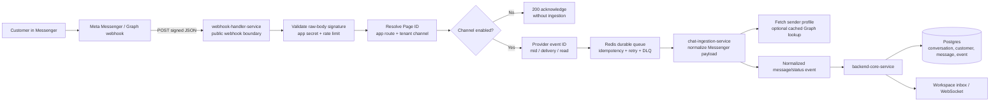
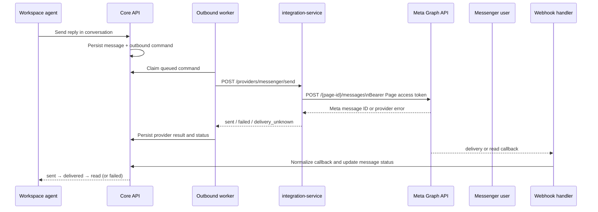

# Facebook Messenger channel: architecture and analysis

This document describes how ZayOS connects Facebook Page Messenger to a tenant
workspace, how an inbound chat becomes a conversation, how replies are sent,
and what still needs live Meta certification.

The provider is called `messenger` internally. `facebook` is accepted as a
legacy alias at the edge and is normalized to `messenger`.

## 1. System graph

### Inbound messages, delivery receipts, and read receipts



The webhook handler acknowledges only after the event has been claimed and
queued. Duplicate provider events are acknowledged without creating a second
conversation message. Queue failures remain retryable; exhausted events go to
the operator dead-letter queue.

### Outbound agent replies



## 2. Connection and routing model

ZayOS supports two Meta app modes. The mode is stored per tenant in
`tenant_channel_settings.facebook_mode`.

| Mode | Meta app | Webhook route | Tenant routing |
| --- | --- | --- | --- |
| `platform_one_click` | Shared platform app seeded from `META_APP_ID`, `META_APP_SECRET`, and `META_WEBHOOK_VERIFY_TOKEN` | Shared `/webhooks/messenger/{platform-routing-segment}` | Page ID resolves to the tenant channel |
| `byo_app` | One merchant-owned Meta app | Per-app `/webhooks/messenger/{t_xxx}` route | App route first, then Page ID resolves to the tenant channel |

The Page ID is the authoritative external account identifier. A channel ID
must never be inferred from the sender PSID. The sender PSID identifies the
Messenger user in the Page context; it is used for the customer and
conversation mapping.

Meta app secrets, verify tokens, and Page access tokens are encrypted at rest.
The webhook handler reads app configuration through authenticated internal core
routes. It does not accept an app secret from the public webhook request.

## 3. Inbound event processing

The webhook handler performs these checks in order:

1. Apply the Messenger rate limit.
2. Load the Meta app webhook configuration.
3. Verify `X-Hub-Signature-256` against the exact raw request body and app secret.
4. Require a Page webhook payload (`object: page`) and extract `entry[0].id`.
5. Resolve the Page ID and app route to an immutable ZayOS channel and tenant.
6. Acknowledge disabled channels without forwarding the event.
7. Derive a stable event ID: message `mid`, delivery watermark/mids, or read watermark.
8. Claim the channel-scoped idempotency key and enqueue the event.
9. Forward the queued event to chat ingestion.

Chat ingestion normalizes Messenger payloads into the provider-independent shape:

| Meta value | ZayOS value |
| --- | --- |
| `sender.id` | `senderId` / customer external ID |
| `entry.id` or `recipient.id` | `pageId` metadata |
| `message.mid` | `externalMessageId` and provider event ID |
| sender ID / Page context | `externalConversationId` |
| `message.text` | `content` |
| `message.attachments[]` | normalized attachment `{ type, url, fileName? }` |
| `delivery.mids` / watermark | outbound delivery status event |
| `read.watermark` | outbound read status event |

Sender profile lookup (`name`, fallback first/last name, and `profile_pic`) is
best effort and cached. A Graph profile failure does not prevent the message
from reaching the inbox.

Inbound attachments are downloaded by core into ZayOS file storage. Keeping a
Meta CDN URL alone is not sufficient because the URL is provider-owned and may
expire.

## 4. Outbound behavior

The core channel adapter sends through `integration-service`; the workspace and
core do not call Meta directly. The integration service uses the Page access
token and supports:

- text messages;
- image, video, audio, and file attachments;
- attachment upload before sending when required;
- HTTPS Graph API calls with a configurable API version;
- provider message ID capture;
- provider errors and retry recommendations.

Messenger's Send API accepts either text or an attachment payload. The client
validates message type, caption length, attachment size, content type, and
HTTPS Graph configuration before making the request.

Outbound commands are persisted before provider dispatch. This gives the
system a durable `queued` → `sending` → final result lifecycle. A transport
timeout is recorded as `delivery_unknown`, not as a confirmed failure, because
Meta may have accepted the message before the connection failed.

## 5. Message status model

| Provider signal | ZayOS result | Notes |
| --- | --- | --- |
| Graph send response | `sent` or `failed` | Stores Meta message ID when available |
| `message_deliveries` | `delivered` | Matches the external message ID in `delivery.mids` |
| `message_reads` | `read` | Applies the Page watermark to eligible outbound messages |
| Graph/network ambiguity | `delivery_unknown` | Requires operator/retry policy; must not be silently treated as delivered |

Status updates are monotonic: an older delivery callback must not downgrade a
message already marked `read`.

## 6. Required configuration

### Shared platform app

```text
META_APP_ID
META_APP_SECRET
META_WEBHOOK_VERIFY_TOKEN
META_PROVIDER_APP_ROUTING_ID
WEBHOOK_PUBLIC_BASE_URL
```

Legacy `MESSENGER_*` names are supported as fallbacks where noted in the
deployment configuration. `CORE_API_URL` must be available to the webhook
handler for app and Page resolution. Core and webhook-handler must use the same
provider credential encryption key.

### Tenant channel

- Facebook Page ID
- Page access token
- enabled Messenger webhook fields: `messages`, `messaging_postbacks`,
  `message_deliveries`, and `message_reads`
- for BYO: valid tenant App ID/secret, live confirmation, callback URL, and
  verify token

See [facebook-messenger-setup.md](./facebook-messenger-setup.md) for the
operator runbook and [custom-owned-messenger-setup.md](./custom-owned-messenger-setup.md)
for the BYO flow.

## 7. Analysis: strengths and risks

### Strengths already present

- Shared and BYO Meta apps are isolated by provider-app route and Page ID.
- Raw-body signature verification protects the public webhook boundary.
- Redis queueing, retries, stale-work recovery, and DLQ handling protect Meta's
  retry-based delivery model.
- Provider event idempotency prevents duplicate inbound messages and duplicate
  status updates.
- Outbound commands are durable and separate from inbound webhook processing.
- Messenger media is copied into ZayOS storage instead of relying only on Meta
  CDN references.
- Provider delivery/read callbacks are represented in the common conversation
  status model.

### Remaining certification and operational work

- Perform a live Meta test for each supported app mode, including Page
  subscription, inbound message, outbound reply, delivery, read, and invalid
  signature cases.
- Confirm the deployed Meta Graph API version and required permissions against
  the current Meta developer configuration before production certification.
- Monitor webhook error rate and delivery pauses; Meta can stop sending events
  after sustained endpoint failures.
- Define retention and deletion behavior for raw provider payload metadata and
  downloaded customer media.
- Add an automated health check for Page subscription state and token expiry or
  revocation where Meta exposes it.
- Keep the production launch checklist explicit: Messenger should be marked
  certified or explicitly deferred; passing unit/e2e fixtures alone is not live
  provider certification.

## 8. Code and test map

| Concern | Source |
| --- | --- |
| Public webhook validation, Page routing, dedupe, queue | `services/webhook-handler-service/src/app.service.ts` |
| Messenger normalization and profile lookup | `services/chat-ingestion-service/src/app.service.ts` |
| Graph Send API and attachment handling | `services/integration-service/src/messenger.client.ts` |
| Provider adapter boundary | `backend-core-service/src/channel-adapter/provider-channel.adapter.ts` |
| Conversation persistence and status updates | `backend-core-service/src/conversation/conversation.service.ts` |
| Shared/BYO app model | `backend-core-service/src/channel/entities/meta-app.entity.ts` |
| Tenant channel model | `backend-core-service/src/channel/entities/tenant-channel.entity.ts` |
| Webhook e2e and signature/routing coverage | `services/webhook-handler-service/test/app.e2e-spec.ts` |
| Messenger client coverage | `services/integration-service/src/messenger.client.spec.ts` |
| Core delivery/read coverage | `backend-core-service/src/conversation/provider-message-status.spec.ts` |

