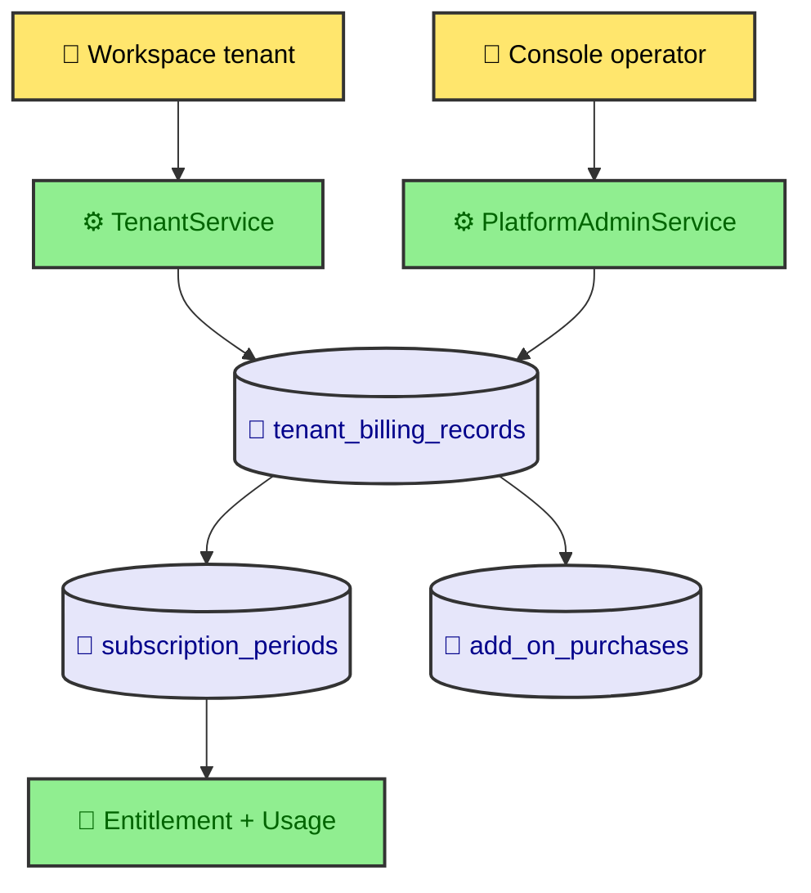
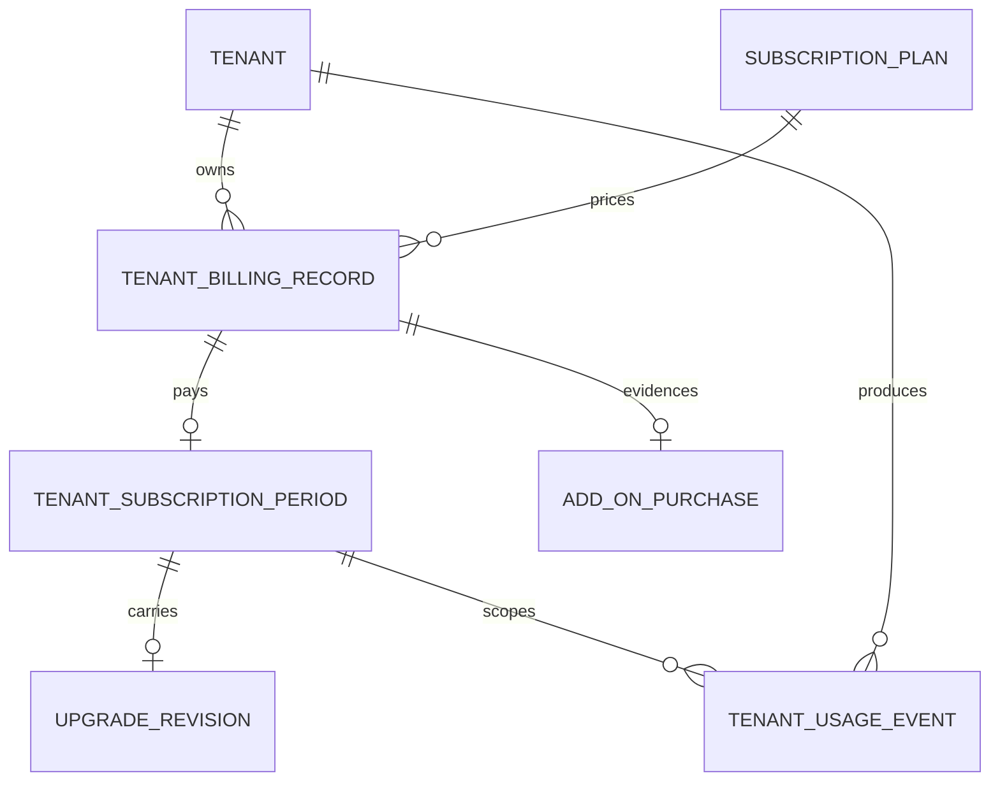
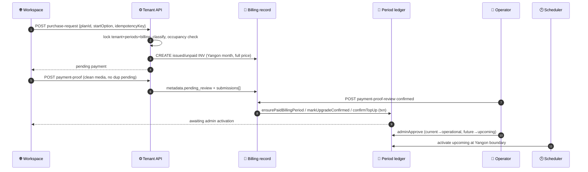
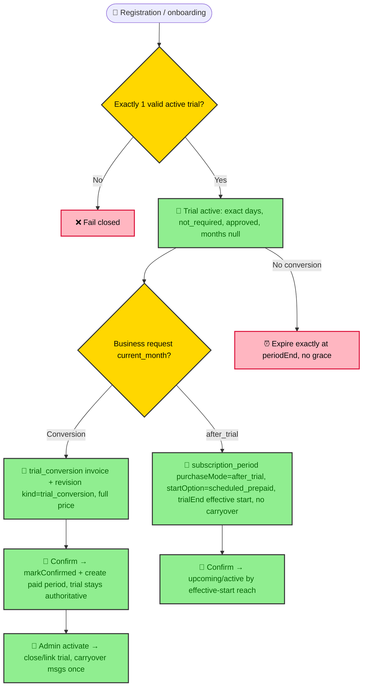
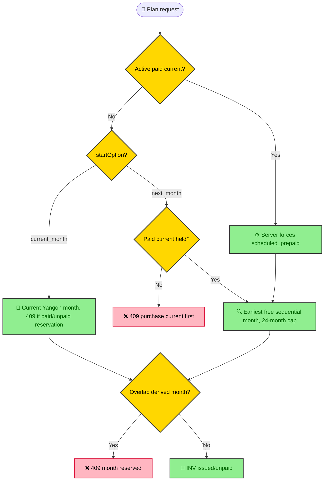

# Plans & Billings — Complete Guide (code truth 2026-09-28)

**Status:** Canonical companion to `design-summary.md` (2026-08-24, drifted)
**Scope:** subscription plans, periods, trials, conversion, after_trial, sequential months,
upgrades, top-ups, invoices, guards/validations, usage limits, frontend gates
**Rule:** code is source of truth. Pins verified 2026-09-28.

> `design-summary.md` §12.1 dual axis and `api_requests` quota are historical.
> Live: single `review_status`, no API quota (Plan 36), full-balance confirm only.

## 1. File inventory (this session)

### Docs inputs
- Planning: 47, 15, 12, 09, 16, 13, 19, 36, 28, 25, 24, 26, 27, 31, 40, 43, 44, 45, 50, 46, 08, 11
- Analysis: `mydocs/analysis/6-subscription-billing/17-consolidated-billing-truth-2026-09-04.md`,
  `16-2026-08-31-usage-tracking-architecture.md`, `13, 11, 8, 1`
- Reports: `5-usage-quota-business-semantics`, `1-plan-request-audit`, `6-billing-docs-drift`
- Rules: `mydocs/rules/state-management-rules.md`; WIP: `.opencode/wip.md` (Plan 47)

### Backend
- Guards: `backend-core-service/src/common/guards/entitlement.guard.ts:24` (pass-through),
  `common/guards/tenant.guard.ts:10`, `platform-admin.guard.ts`, `roles.guard.ts`,
  `auth/guards/jwt-auth.guard.ts`, `websocket/guards/ws-jwt.guard.ts`,
  `conversation/conversation-ingest-guard.spec.ts`
- Usage: `usage/usage-limit.service.ts:219,352`, `usage/entities/tenant-usage-event.entity.ts`,
  `usage/usage.module.ts`, `usage/usage-billable-path.util.ts`
- Period: `subscription-period/subscription-entitlement.service.ts:157`,
  `subscription-entitlement.types.ts:14`, `subscription-period.service.ts:56,186,214,300,370,743,782,828`,
  `subscription-period.types.ts:216,298`, `subscription-period.transitions.ts:19,32,86`,
  `subscription-period-scheduler.service.ts:520,607`, controllers tenant/platform
- Billing: `tenant/subscription-billing.util.ts:23,39`, `tenant/tenant.service.ts:674,1300,1478,1630,1869,1918,2000`,
  `platform-admin/platform-admin.service.ts:896,1053,1215,3373,3431,3611,3681`,
  `platform-admin/entities/tenant-billing-record.entity.ts:69`,
  `tenant/entities/subscription-plan.entity.ts:27`, `auth/auth.service.ts:1300`
- Capacity: `media/media-library.service.ts:291`, `channel/channel-capacity.util.ts:108`,
  `tenant/telegram-managed-bot.service.ts:525`

### Frontend
- Workspace: `dashboards/workspace/lib/queries/billing.ts:41,182,294,444`
  (`resolveCurrentPlanId`, `useSubscriptionGate`, `useWorkspaceWarnings`, `buildQuotaView`),
  `components/billing-v2-tabs.tsx`, `components/billing-history-tab.tsx`,
  `components/my-plan-tab.tsx`, `components/payment/compact-plan-card.tsx:24`,
  `lib/public-subscription-plans.ts`, `app/pricing/pricing-client.tsx`,
  `tests/e2e/billing.spec.ts:142`
- Console: `app/platform-console/billing/page.tsx`, `billing-accounts/page.tsx`,
  `subscription-plans/page.tsx`, `usage/page.tsx`, `merchants/[merchantId]/page.tsx`,
  `components/tenants/usage-analytics-modal.tsx`

## 2. Architecture (billing = evidence, period = truth)

- Catalog `subscription_plans`: `planType business|trial`, directional
  `inbound/outbound NULL=unlimited 0=blocked`, `maxChannels/maxAgents/storageLimitGb`,
  `allowedProviders[]`, `monthlyPrice MMK`. Deprecated: `messageLimit/messageQuotaMode/durationDays` (business).
- Evidence `tenant_billing_records`: single axis `review_status in_review|confirm|reject`,
  Yangon `billingPeriodStart/End date`, `amountDue/Paid decimal(12,2)`, `INV-00005` seq,
  `metadata {idempotencyKey, source, purchaseRequestType, purchaseMode, requestedStartOption,
  startOption, monthStartAt, trialPeriodId, scheduledStartAt, paymentProof+submissions+reviews, trial:true}`.
- Truth `tenant_subscription_periods`: `UQ_one_active_paid + UQ_one_active_trial`,
  `UQ_billing_record`, `period_status upcoming|active|expired|cancelled`,
  `payment_status pending|paid|failed|refunded|not_required(trial)`,
  `adminActivationStatus pending|approved`, `[monthStartAt,monthEndAt)` Yangon half-open,
  immutable `quotaSnapshot`, `convertedTo/FromPeriodId`.
- Resolver `SubscriptionEntitlementService`: operational paid wins; confirmed-but-pending
  paid + unexpired trial → trial authoritative. Codes:
  `NO_ACTIVE_PAID_PERIOD|MULTIPLE|OUTSIDE_WINDOW|PAYMENT_NOT_CONFIRMED|AWAITING_ACTIVATION|REFUNDED|TRIAL_EXPIRED`.
- Limit math: snapshot authoritative (explicit null stays null) → plan fills legacy gaps →
  capacity default 0 blocked; `effective = base==null ? null : base+topUp`; `blocked = effective<=0`.
  Upgrade: target snapshot + message-only carryover + topUps.

## 3. Invoice lifecycle

Entries: `tenant.service.ts:674` txn (`pessimistic_write` tenant+periods+billing);
`idempotencyKey` required; plan explicit>assigned must be `active`; `contact-only` 400;
replay same key returns stored row; `paymentAccountId` validated 400; company-email
invoice notice fire-and-forget. Proof `tenant.service.ts:1918`: 404 unknown; 400 if
`confirm`/`reject`/unclean; 409 dup `pending_review`. Review
`platform-admin.service.ts:1215`: requires `pending_review` (except idempotent re-confirm);
reject needs `safeReason` proof-level only; confirm sets `confirm + amountPaid=normalize(dto??proof.paidAmount)
+ paidAt`, `assertPaymentAmounts` full-balance-only, then activation txn.

## 4. Trial, conversion, after_trial

Rules: `validateTrialPlanConfiguration:743` (trial type, durationDays int>0,
requestable=false, renewable=false, topUpAllowed=false, autoApprove=true);
`isTrialOperational:782` exact `[start,end)`; trial rows excluded from occupancy
(`tenant.service.ts:914`) and confirm no-op (`platform-admin.service.ts:3439`);
`hasOpenTrialConversion/hasOpenAfterTrialRequest` → one trial path, same key replay,
different key 409. Conversion targets current Yangon month, no price/dimension check,
one per trial. After-trial targets `yangonMonthStart(trialEnd)`, overlap 409,
confirm requires effective start inside month.
Registration `auth.service.ts:1300`: trial-plan 400, current Yangon bounds shared by
record/period/email, `purchaseRequestType=subscription_period + startOption=current_month`,
proof `pending_review + paidAmount=full price`, `createRegistrationPeriod active/pending/pending`.

## 5. Sequential months (current|next|scheduled_prepaid)

Rules: `resolveStartOption:56` (`scheduled_prepaid` if active paid;
`STALE_NEXT_MONTH` if now≥target; `START_OPTION_REQUIRED`); confirm stale guard
`platform-admin.service.ts:3516`; `transitions.ts` paid future stays `upcoming`,
pending/failed never confers access; Yangon assert `:3373` (UTCDate==1, end==next 1st);
`scheduled_prepaid upcoming→active` by scheduler at boundary.

## 6. Upgrade + top-up

- Upgrade (`createCurrentMonthUpgrade:1300`): active paid overlapping current + business
  target + price>current; `assertUpgradeDoesNotReduceDimensions` 5 dims; one non-cancelled
  revision per period (terminal occupies slot), idempotent same key; full target price;
  `requested→pending_payment→pending_approval→approved`, `rejected|stale|cancelled` terminal;
  `cancelUpgradeRevision:1869` only `requested|pending_payment`; confirm
  `markUpgradePaymentConfirmed:3611` never touches period.
- Top-up (`subscription-add-on-purchase.service.ts:94`, `active-period.util.ts:8`):
  server-resolved active paid only; reject trial/none/upcoming/expired/unpaid/awaiting
  (`TOPUP_NOT_AVAILABLE_FOR_TRIAL`); stacking; `expiresAt==periodEnd`; paid cannot cancel.
- Legacy Lead plan-change compat: `requestPlanChange:2000` (active target, ≠current, one open,
  member check) / cancel (converted/closed 400); `changeTenantSubscriptionPlan:1397` operator
  compat; downgrade = next-period/lead, no revision. Reverse `1360`: only
  `confirm→in_review + amountPaid=0`, reason required, no entitlement rollback.

## 7. Guards + usage limits matrix

| Layer | Guard | Rule / code |
|---|---|---|
| Route | `EntitlementGuard:24` | pass-through `true` (legacy row must not 404 new tenants) |
| Route | `TenantGuard:10` | auth + emailVerified + tenantId scope; platform_admin bypass |
| Route | `PlatformAdmin/Roles/JWT/WS` | catalog/review/activate scoped; UI finance vs ops explicit |
| Service | Channel `createChannelInTransaction` | `CHANNELS_PLAN_LIMIT_REACHED 409` |
| Service | `MediaLibraryService:291` | `STORAGE_LIMIT_REACHED 413`, base+topUp GB |
| Service | `assertPlanLimitAvailable(csrs)` | `CSRS_PLAN_LIMIT_REACHED 409` |
| Service | `telegram-managed-bot:525` | `allowedProviders` snapshot check |
| Usage | `assertPeriodUsageAvailable:219` | lock periods, resolve entitlement, `SUM(period_id+direction)`, `used+qty>limit → 429 INBOUND/OUTBOUND_MESSAGE_QUOTA_EXHAUSTED`, 409 `SUBSCRIPTION_PAYMENT_REQUIRED/AWAITING_ACTIVATION/TRIAL_EXPIRED/NOT_ACTIVE` |
| Usage | `billableUsagePolicy:28` | inbound bills after durable message; outbound on Agent accept; callbacks non-billable; `markProviderMessageNonBillable` zero on disabled-before-dispatch |
| Usage | `usageLimitPolicy:37` | `hard_limit`, no grace overage; live `SUM()`, no cache/partition |
| Billing | submit/review | 400/404/409 per §3; `safeReason` on reject; full-balance confirm |
| Billing | manual create/update | Yangon assert + overlap 409 (`reject` frees month, trial ignored) |
| Frontend | `useSubscriptionGate:182` | `canConsume = hasActivePeriod && !unlimited && !blocked && remaining>0` |
| Frontend | `useWorkspaceWarnings:294` | 80% warn, 95%/blocked critical (in/out only), expiry ≤7d/≤2d |

## 8. Frontend gates

- `lib/queries/billing.ts`: keys `all/overview/periods/usageSummary/...`;
  stale `overview 5m / periods 60s / usage 30s / publicPlans 10m`;
  `resolveCurrentPlanId` trial-first; `buildQuotaView` merges summary+periods;
  precise invalidation (`submitProof→overview`).
- Workspace tabs: `billing-v2-tabs`, `my-plan-tab` (quotaView → base/carryover/topUp →
  add-ons → upcoming), `packages-tab` (PlanCard modes, `crypto.randomUUID()` idempotency,
  `Continue payment → billing-history`), `billing-history-tab` (Paid/Submitted/Under-review/
  Rejected/Awaiting/Unpaid; `csrMediaApi.upload(billing-payment-proof)` + submit; dup guard),
  `payment/compact-plan-card.tsx:24` limits display.
- Console: `billing` (review+receipt, Confirm, Activate/Approve/Approve-upgrade;
  super/ops/finance update, read-only view), `billing-accounts` (QR/icon upload),
  `subscription-plans` (public `billingInterval` + price validation), `usage` pressure feed.
- State: TanStack Query server-only; Zustand `ui-store.dismissedWarningIds` only;
  banner in `workspace-shell`. E2E `billing.spec.ts:142` fixtures
  (usageSummary + entitlement + quotaState).

## 9. Linkage contracts (post-hoc referential checks)

- Period (required): `subscription-period-billing-linkage.util.ts:36 validatePeriodBillingLinkage`
  codes `missing_billing_record|null FK or dangling | cross_tenant_billing_record |
  plan_mismatch (only if billing.subscriptionPlanId set) | payment_mismatch (paid period ⇒
  billing review_status=confirm) | window_mismatch (period [start,end) covered by billing
  [start,end] via `yangonCalendarDate(start)` + `yangonCalendarDate(end-1ms)`)`.
  `summarizeBillingLinkage:116 → {validCount, exceptionCount, exceptions[]}` for
  cutover/recon; legacy rows = exceptions, never auto-rewritten. `UQ_billing_record where NOT NULL` = 1:1.
- Top-up (optional): `subscription-add-on-purchase-billing-linkage.util.ts:40 validatePurchaseBillingLinkage`
  codes `cross_tenant (incl. dangling FK) | payment_mismatch | window_mismatch`
  (effective→expires same Yangon last-day rule). No `plan_mismatch` (product, not plan).
  Null `billing_record_id` = explicit operator grant (valid if not paid-linked).
- Upgrade revisions: `subscription_period_upgrade_revisions.billing_record_id SET NULL`,
  one non-cancelled/period, full price, carry inbound/outbound only (+topUps snapshot),
  late approval → `stale` + manual recon.
- Reconciliation (legacy entitlement projection): `platform-admin.service.ts:770`
  codes `APPROVED_INVOICE_WITHOUT_ENTITLEMENT | APPROVED_INVOICE_PLAN_MISMATCH |
  ACTIVE_ENTITLEMENT_WITHOUT_MATCHING_APPROVED_INVOICE | IN_REVIEW_INVOICE_OVERLAPS_ACTIVE_ENTITLEMENT`;
  manual-correction only, never rewrites evidence.

## 10. DTO / validation specifics

- `CreateSubscriptionPurchaseRequestDto`: `idempotencyKey string required`,
  `startOption enum current_month|next_month|after_trial`,
  `subscriptionPlanId UUID4 optional` (fallback assigned plan),
  `paymentMethod enum bank_transfer|kbzpay|wavepay|cash optional`,
  `paymentAccount string optional` (legacy free-text),
  `paymentAccountId UUID4 optional` (Plan 31 live module), `note`, `requestedBy UUID4`
  (session user wins anti-spoof in `tenant.controller.ts:202`).
- `ReviewPaymentProofDto` (`tenant-billing-record.dto.ts:111`):
  `outcome enum confirmed|rejected` (Phase 6 rename, never `approved`),
  `safeReason required on rejected`, `amountPaid?, paidAt?` optional overrides
  (fallback `proof.paidAmount/paidDate`; full-balance assert applies).
- `Create/UpdateTenantBillingRecordDto`: `subscriptionPlanId UUID`,
  `reviewStatus enum in_review|confirm|reject`, `paymentProofFileId varchar`
  (opaque `file-*`, not UUID), `billingAccountRef string` (interim) + FK via entity,
  amounts/currency/notes/metadata.
- `CreateSubscriptionPlanDto`: `planType business|trial` (default business),
  `requestable/renewable/topUpAllowed/autoApprove` booleans (trial must be
  `false/false/false/true`, enforced `platform-admin.service.ts:561` + validator spec),
  `monthlyPrice`, `durationDays int≥1` (trial length; legacy for business),
  directional `inbound/outbound ≥0|null`, `maxAgents/maxChannels/storageLimitGb ≥0`,
  `allowedProviders ∈ messenger|telegram|viber|tiktok unique`, `features.public.*`
  landing profile, `status active|inactive|archived`.
- `RegisterFromPricingDto`: `subscriptionPlanId UUID`, company/personal emails,
  password policy (`MINIMUM_PASSWORD_LENGTH` + regex), `paymentMethodOptionId string`
  (live billing-account id), `paymentProofFileId?` (platform-scoped
  `POST /auth/register/payment-proof-upload` + claim validation), `note?`,
  `acceptTerms=true`.

## 11. Billing-account integration (Plan 31 + Plan 47 R1)

- Entity `billing-account.entity.ts:22`: `type bank_account|digital_wallet`,
  `accountName/accountNo(text)/phno(text)/qr(varchar nullable)/icon`,
  `isPublic/isActive`, `createdBy/updatedBy RESTRICT`.
- Public `GET /public/billing-accounts` includes QR-less wallets
  (`PublicDigitalWalletItemDto.qr` optional); controller crash-guarded for stale QR
  placeholders; 10-min frontend cache (throttled upstream).
- Purchase/registration validate `paymentAccountId` up front → 400 stale id
  (not FK 500); record links `billingAccountId` + `metadata.selectedPaymentAccount(Id)`;
  invoice email names real destination. Seed: `seed:demo` 2 accounts (KBZ Bank + KBZPay).
- Proof `paymentMethod` mapped from account (`bank_transfer|kbzpay|wavepay`) via
  `mapBillingAccountToPaymentMethod` (rebuilt after Plan 47 incident).

## 12. Scheduler full rules

- Service `subscription-period-scheduler.service.ts:42` owns Yangon-boundary transitions
  (not grace scheduler); opt-in `SUBSCRIPTION_PERIOD_SCHEDULER_ENABLED`, interval
  default 300s; health `{enabled,running,intervalMs,lastStarted/Completed/Failed,lastResult}`.
- Per run `processDuePeriods`: expire active paid where `periodEndAt<=now`
  (`active→expired`, `scheduled_expiry`); activate upcoming paid where
  `paid + approved + periodStartAt<=now` (`upcoming→active`, `activationReason=scheduled`,
  `period-activation:{id}` idempotent, `metadata.scheduledAfterTrial` flag);
  project legacy `tenant_entitlements` → `paid_active` (kept for compat);
  expire add-on purchases/components past `expiresAt`.
- `processTrialExpiry:607`: lock trial row, `active→expired` at exact `period_end_at`,
  `trial_period_expired` idempotent; never grants grace/renewal, never becomes paid row.
- Result counts `{tenantsScanned/Skipped, periodsExpired/Activated, purchasesExpired,
  trialPeriodsExpired, reconciliationExceptions}`.

## 13. Auth / audit boundaries

- Workspace billing roles `common/constants/tenant-roles.ts:9 tenantBillingRoles =
  [owner, admin, supervisor, finance]`; `@Roles(...tenantBillingRoles)` +
  `@AllowExpiredAccess()` on purchase/proof/plan-change/add-on endpoints
  (`tenant.controller.ts:190,215,241`) so expired tenants can pay/recover;
  `requestedBy` = session user (anti-spoof).
- Platform scoped via `platform-admin.guard + roles.guard`; console billing page
  read-only for non finance/ops/super-admin.
- Tenant isolation: every read/mutation tenant-scoped; cross-tenant linkage rejected
  (`cross_tenant_billing_record`).
- Audit `@AuditLog`: `tenant_subscription_purchase_requested`,
  `tenant_payment_proof_submitted`, `tenant_plan_change_requested`,
  `upgrade_requested/revision_created/requested→confirmed/approved/rejected/cancelled/stale`,
  `trial_period_created/expired/conversion_requested`, `period_created/payment_confirmed/
  admin_activation_approved/activated/expired`, add-on purchase/confirm/expire;
  each with actor/type/tenant/time/source/reason/old-new/idempotencyKey.

## 14. API behavior contract + error families

- Tenant (`tenant.controller.ts`): `GET /tenants/billing` (overview),
  `GET /tenants/usage-summary` (period-scoped, `MissingActivePeriodError→SUBSCRIPTION_*`),
  `POST /tenants/billing/purchase-requests`, `POST /tenants/billing/:id/payment-proof`,
  `POST|GET|.../cancel plan-change-requests`, add-on list/create; all idempotent where retried,
  stable plan IDs, server-side period resolution wins.
- PlatformAdmin: `GET /platform-admin/billing-records`, `.../tenants/:id/billing-reconciliation`,
  `GET|POST .../billing-records`, `PUT .../:recordId`, `.../:recordId/payment-proof-review`,
  `.../:recordId/reverse-payment`, `.../change-plan`; Public: `GET /public/subscription-plans(+/:id)`
  filters `active + requestable + planType!=trial + visible!=false`, ordered price/created
  (`platform-admin.service.ts:2523`).
- Codes: `PLAN_NOT_FOUND | PLAN_NOT_REQUESTABLE (contact-only/trial/non-requestable) |
  TRIAL_CONFIGURATION_INVALID | SUBSCRIPTION_PERIOD_NOT_ACTIVE | SUBSCRIPTION_PERIOD_AWAITING_ACTIVATION |
  SUBSCRIPTION_PAYMENT_REQUIRED | SEQUENTIAL_PERIOD_BLOCKED | UPGRADE_TARGET_NOT_HIGHER |
  UPGRADE_ALREADY_USED (+protected-dimension reduce) | TOPUP_NOT_AVAILABLE_FOR_TRIAL |
  TOPUP_NOT_AVAILABLE_FOR_PERIOD | BILLING_RECORD_LINK_INVALID | STALE_NEXT_MONTH |
  INBOUND/OUTBOUND_MESSAGE_QUOTA_EXHAUSTED | CHANNELS/STORAGE/CSRS_LIMIT_REACHED`.
- Responses distinguish `active|upcoming|pending|awaiting_activation|rejected|cancelled|
  expired|stale`; payment + plan ops transactional + auditable.

## 15. Public catalog gating

- `getPublicSubscriptionPlans:2523 where {status:active, planType:Not(trial), requestable:true}`
  + `features.public.visible!=false`, sort `monthlyPrice,createdAt`;
  `getPublicSubscriptionPlanById:2537` 404 unless same + visible.
  Trial never in marketing catalog; non-requestable business excluded from purchase choices.
  Frontend `toDisplayPlan()` no price fallback (`Pricing unavailable / Custom proposal`);
  `contact-only` routes to `/contact`, never self-serve.

## 16. Acceptance matrix + scale limits

| Scenario | Expected |
|---|---|
| Self-register valid trial | tenant + 1 active auto-approved trial |
| Self-register invalid trial config | fail closed, no arbitrary plan |
| Console create no-trial | no period, may request current-month |
| Top-up trial / no paid / awaiting approval | reject (trial-specific) |
| Multi top-up active paid | stack, expire with period |
| Top-up unlimited dim | reject unnecessary |
| Fresh/upgrade/conversion/after_trial request | INV + frozen snapshot; activate on pay+approve |
| Pending conversion | trial authoritative + visible |
| Approved conversion | paid operational + msg carryover once |
| Trial expiry | exact end, no grace |
| Same/lower upgrade, 2nd upgrade, late upgrade | reject / slot-consumed / stale |
| Sequential after confirmed | queue; after pending/rejected → blocked |
| Add-on | never blocks sequential |
| Dup confirm / cross-tenant / over-limit / stale | idempotent / reject / true usage shown / unavailable-not-zero |
- Scale: `tenant_usage_events` append-only, live `SUM()`, no cache/partition/TTL;
  API retry double-count, provider-fail still billed, API path race (no `pessimistic_write`);
  legacy dead code (`sumUsage/getEffectiveLimits`) retained; `mydocs/` gitignored.

## 17. Deltas / follow-ups

- `reverseTenantBillingPayment` has no entitlement rollback — ops runbook via recon
  (`§9` codes) only.
- `tenant_usage_events` unbounded, no cache/partition/TTL; API retry double-count
  (random UUID), outbound provider-fail still billed, API path no `pessimistic_write` race.
- `mydocs/` gitignored — truth docs local-only until ignores change.

## 18. Plan 53 — unlimited capacity dims + effortless plan modal (2026-09-28)

- `max_channels/max_agents/storage_limit_gb` nullable (`NULL` = unlimited, `0` = blocked);
  migration `1782446500000-AllowUnlimitedCapacityDims`; existing rows keep finite numbers.
- Snapshot/resolver preserve `null` (`buildQuotaSnapshot`, `aggregateEffectiveLimits`,
  `assembleUpgradeEffectiveLimits`, `baseLimitForDimension` team shim); top-up on an
  unlimited dim rejects as unnecessary (all 5 dims); upgrade `null→null` only.
- Enforcement skips when `null` (channels/storage/seats); seat-limit entitlement `null`
  wins over legacy fallback (`tenant.service.ts:assertPlanLimitAvailable`).
- Console `subscription-plans` dialog: `max-w-3xl`, live summary bar, per-field
  `[number + Unlimited toggle]` (default OFF + `0`), required `*` + placeholders + hints,
  Landing/Flags collapsed; plan cards render Unlimited.
- Workspace: `canConsume` true for unlimited (active + unblocked); pricing/compact cards
  and `toDisplayPlan` render Unlimited; `0` renders Blocked/`Up to 0` (no longer Unlimited).
- Demo seed `Unlimited Pilot` (inbound 10000, rest unlimited, 800000 MMK placeholder).
- Full plan: `mydocs/planning/53-2026-09-28-unlimited-quotas-and-plan-modal.md`.

## 19. Plan 54 — chained period upgrades (2026-09-29)

- Slot rule replaced: many revisions per period allowed; only one IN-FLIGHT
  (`requested|pending_payment|pending_approval`) at a time
  (migration `1782446600000-UpgradeChaining`, pending-only unique index).
- New request allowed unless a pending revision exists (same-key replays);
  terminal (`approved|rejected|stale|cancelled|superseded`) never blocks.
- Target must beat the latest effective plan (price + all 5 dims; `null→null`
  only) — ping-pong downgrades rejected.
- Approval computes carryover vs currently effective limits (resolver, chained),
  supersedes the prior approval (`upgrade_superseded` event); resolver follows
  newest `approved`; late approvals still go `stale` per revision.
- Workspace: `upgradeAvailable` = operational paid + no pending revision; target
  card gets Continue payment + Cancel request (new `POST
  /tenant/billing/upgrade-revisions/:id/cancel` + `useCancelUpgradeRevision`),
  others an in-progress note; priced-but-reducing targets show Not-an-upgrade.
- Full plan: `mydocs/planning/54-2026-09-29-chained-period-upgrades.md`.
