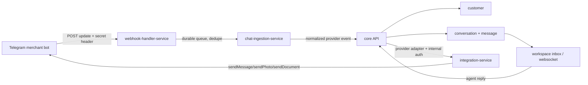

# Telegram shopping bot — current stage

_Investigation date: 2026-10-05. Claims below are verified against the cited repository files; anything not demonstrated by code is marked **Unverified**._

## 1. Summary

ZayOS has the Step 1 Telegram foundation and the Step 2 browse flow implemented for private chats. Tenant-owned bots use channel-scoped webhook registration, `message` and `callback_query` updates, durable edge ingestion, tenant-scoped customer/conversation persistence, and blocked-customer handling. The commerce layer now supports `/start` and `/menu`, a tenant-language main menu, Products, Shop info, Orders/agent placeholders, stable six-item product pages, product detail, an authoritative quantity stepper, Redis-TTL sessions keyed by tenant/channel/Telegram user, compact versioned callbacks, callback acknowledgement/rate limiting, and stale-menu recovery.

Evidence: `backend-core-service/src/telegram-bot/telegram-commerce.service.ts`, `telegram-bot.router.ts`, `telegram-session.service.ts`, `telegram-bot.types.ts`; `services/chat-ingestion-service/src/app.service.ts`; `backend-core-service/src/conversation/conversation.service.ts`; `backend-core-service/src/customer/entities/customer.entity.ts`; and `backend-core-service/src/tenant/telegram-managed-bot.service.ts`.

Steps 3–6 remain incomplete: customer order creation and checkout, reservations and expiry, payment methods/proofs/review, Telegram order management, the full template editor, and production hardening/certification work are still open.

## 2. Architecture map

| Responsibility                          | Owner                                     | Evidence                                                                                                                                                                                                                                                                            |
| --------------------------------------- | ----------------------------------------- | ----------------------------------------------------------------------------------------------------------------------------------------------------------------------------------------------------------------------------------------------------------------------------------- |
| Tenant channel, credentials, lifecycle  | Core `TenantService` + `TenantChannel`    | `backend-core-service/src/tenant/tenant.service.ts` (`prepareTelegramLifecycle`, `registerTelegramWebhook`, `encryptCredentials`); `backend-core-service/src/channel/entities/tenant-channel.entity.ts`                                                                             |
| Telegram webhook edge                   | `webhook-handler-service`                 | `services/webhook-handler-service/src/app.controller.ts` serves `/webhooks/telegram/bots/:channelId` directly and `/webhooks/telegram/:channelId` through the generic `webhooks/:provider/:channelId` handler; both call `app.service.ts` `receiveWebhook` and `validateSignature`. |
| Durable webhook queue/idempotency       | `webhook-handler-service`                 | `services/webhook-handler-service/src/webhook-reliability.ts`, `app.service.ts` (`idempotencyStore.claim`, `enqueueClaimedWebhook`, `eventQueue.drain`)                                                                                                                             |
| Provider normalization                  | `chat-ingestion-service`                  | `services/chat-ingestion-service/src/app.service.ts` (`normalizeTelegram`, `forwardToCore`)                                                                                                                                                                                         |
| Domain persistence and customer mapping | Core conversation module                  | `backend-core-service/src/conversation/conversation.service.ts` (`ingestProviderMessage`, `upsertProviderCustomer`, `upsertProviderConversation`); `customer/entities/customer.entity.ts`                                                                                           |
| Agent inbox/realtime                    | Core agent/conversation/websocket modules | `backend-core-service/src/agent/agent.service.ts`; `backend-core-service/src/websocket/gateways/conversation.gateway.ts`                                                                                                                                                            |
| Telegram outbound transport             | Integration service + core adapter        | `services/integration-service/src/telegram.client.ts` (`send`, `setWebhook`, `deleteWebhook`); `backend-core-service/src/channel-adapter/provider-channel.adapter.ts`                                                                                                               |
| Files/media                             | Core media library + file storage         | `backend-core-service/src/media/media-library.service.ts`; `services/file-storage-service/src/app.controller.ts`                                                                                                                                                                    |

## 3. Existing capability inventory

| Capability                                       | Status and evidence                                                                                                                                                                                                                                                                                                                                                                           |
| ------------------------------------------------ | --------------------------------------------------------------------------------------------------------------------------------------------------------------------------------------------------------------------------------------------------------------------------------------------------------------------------------------------------------------------------------------------- |
| Per-tenant Telegram channel                      | Exists. `TenantChannel` is tenant-scoped and stores `channelType`, configuration, credentials, webhook state, and provider account metadata (`backend-core-service/src/channel/entities/tenant-channel.entity.ts`).                                                                                                                                                                           |
| Tenant token validation and duplicate protection | Exists. `TenantService` validates bot identity and rejects an already-connected bot (`tenant.service.ts`, `prepareTelegramLifecycle`, `assertTelegramBotAvailable`); channel creation/update encrypts credentials.                                                                                                                                                                            |
| Webhook registration/deletion/info               | Exists. Core calls integration `/providers/telegram/webhook/{register\|info\|delete}` with service auth (`tenant.service.ts`, `callIntegrationTelegramWebhook`); integration calls Telegram `setWebhook`/`deleteWebhook` (`services/integration-service/src/telegram.client.ts`).                                                                                                             |
| Webhook authentication                           | Exists for merchant bots. `webhook-handler-service` compares `X-Telegram-Bot-Api-Secret-Token` against channel verification data (`app.service.ts`, `verifyWebhook`/`validateSignature`).                                                                                                                                                                                                     |
| Inbound update parsing                           | Partial. `normalizeTelegram` handles text/caption, photo, document, video, audio, voice, sticker, and callback queries. Callback queries expose their id, sender, chat, message, and data and are routed without creating inbox messages. Step 1 now registers `message` + `callback_query`; it does not implement shopping semantics or download Telegram files.                             |
| Inbound idempotency/retries                      | Exists. Edge claims event IDs before enqueue, returns duplicate responses, drains a durable queue, retries/dead-letters failures; core also stores `InboundProviderEvent` with `.orIgnore()` (`webhook-handler-service/src/app.service.ts`; `conversation.service.ts`).                                                                                                                       |
| Customer/channel identity                        | Partial/Exists for messaging. `Customer` stores tenant, optional channel, provider, external ID, profile data, phone, language, location, and Telegram bot reachability (`botBlockedAt`, `botBlockedReason`). Core upserts from normalized messages/callbacks and clears reachability when the customer returns. A separate Telegram-user-vs-chat identity model is **Unverified/not found**. |
| Agent inbox visibility                           | Exists. Inbound messages create tenant-scoped conversations/messages with attachments; `AgentService.getConversations` joins customers, channels, messages, and related orders; websocket gateway exists.                                                                                                                                                                                     |
| Outbound text/media                              | Partial/Exists. Telegram client supports `sendMessage`, `sendPhoto`, `sendDocument`, callback answers, message text/caption/markup edits, and `setMyCommands`; core adapter records sent/failed/delivery-unknown state. Telegram file downloads and commerce keyboard routing remain Missing.                                                                                                 |
| Products/catalog                                 | Exists in core/dashboard. `Product` has tenant, name, price, description, stock quantity, inventory flag, status, images, and category; product controller/service and workspace product pages exist. Telegram catalog presentation is Missing.                                                                                                                                               |
| Orders/line items                                | Exists for workspace-created orders. `Order` supports lifecycle/payment fields, addresses, totals, history, attachments; `OrderItem` stores product/name/SKU/snapshots, quantity, unit price, and total. `AgentService` accepts `CreateOrderFromChatDto.items`.                                                                                                                               |
| Order lifecycle/payment proof                    | Partial. Core has generic status/payment fields and order attachment support, plus manual billing-proof flows for platform subscriptions. A customer-order proof entity/review endpoint and requested `Payment submitted -> Confirmed/Rejected` flow were not found.                                                                                                                          |
| Inventory reservation                            | Missing. `Product.stockQuantity` and `trackInventory` exist, but no order-time reservation/release/expiry mechanism was found in the inspected order/product modules.                                                                                                                                                                                                                         |
| Media upload/download                            | Partial. Core media library creates tenant-scoped signed uploads/download URLs and file storage serves inline images/PDFs. Telegram inbound provider file IDs are kept as attachment metadata; provider-file download to ZayOS media is **Unverified/not found**.                                                                                                                             |
| Tenant template/settings                         | Partial. Tenant has `featureFlags`, language/timezone; channel has welcome message, auto-reply, business hours, notification settings; workspace settings/channel UI exists. Versioned Telegram shopping template/payment-account configuration and editor are Missing.                                                                                                                       |
| Background jobs                                  | Partial/Exists for webhook durability and subscription scheduling. `webhook-reliability.ts` has queue retry/DLQ behavior and `subscription-period-scheduler.service.ts` exists. A payment-timeout/stock-release job was not found.                                                                                                                                                            |
| Internal service auth                            | Exists. Core-to-integration, edge-to-chat-ingestion, and chat-ingestion-to-core calls use `@zayos/internal-service-auth` scopes.                                                                                                                                                                                                                                                              |

## 4. Reusable pieces for the shopping flow

- **Order API/model:** Reuse `Order`, `OrderItem`, `OrderService`, `AgentService` order endpoints, status history, totals, customer/conversation links, and tenant scoping. Do not create a parallel Telegram order model. Evidence: `backend-core-service/src/order/entities/order.entity.ts`, `order-item.entity.ts`, `order/order.service.ts`, `agent/agent.service.ts`.
- **Products:** Reuse `ProductService`, product list/detail DTOs, categories, images, price, status, and `stockQuantity`. Evidence: `backend-core-service/src/product/`.
- **Customer/profile:** Reuse `Customer.profileData`, phone, location, provider/external/channel IDs. Save checkout delivery data there only after deciding a stable profile schema. Evidence: `customer/entities/customer.entity.ts`; provider upsert path in `conversation/conversation.service.ts`.
- **Inbox:** Reuse normalized `Message.attachments`, `Conversation`, `AgentService` filters, websocket events, and existing workspace conversation UI. Payment proof can become an inbound message attachment plus an order linkage, but review actions need a new order-proof contract. Evidence: `conversation/entities/message.entity.ts`, `conversation/entities/conversation.entity.ts`, `agent/agent.service.ts`.
- **Media:** Reuse signed upload/download and tenant scoping in `media/media-library.service.ts` and `file-storage-service`. Add Telegram `getFile`/download handling before treating provider file IDs as durable proof.
- **Provider transport:** Reuse `webhook-handler-service`, `chat-ingestion-service`, `integration-service`, provider adapter, and service auth. Add a Telegram commerce application layer behind the normalized event path rather than duplicating webhook plumbing.

## 5. Gap analysis

| Required flow capability                                   | Status                   | Evidence / note                                                                                                                                                                                         |
| ---------------------------------------------------------- | ------------------------ | ------------------------------------------------------------------------------------------------------------------------------------------------------------------------------------------------------- |
| One bot per tenant + webhook                               | **Exists**               | Channel is tenant-scoped; lifecycle registers channel-specific URL and secret.                                                                                                                          |
| `/start` and `/menu` welcome/greeting/buttons              | **Exists (Step 2)**      | `backend-core-service/src/telegram-bot/telegram-commerce.service.ts` handles both commands, renders tenant-default-language Products, Shop info, Orders, Chat with agent, and registers commands.       |
| Product list and pagination                                | **Exists (Step 2)**      | `telegram-commerce.service.ts` renders six active products per page, edits list messages for paging, cleans up old screens, and uses compact callbacks. Categories/search remain deferred.              |
| Product detail + quantity stepper                          | **Exists (Step 2)**      | `telegram-commerce.service.ts` renders authoritative product price/stock/image data and quantity controls; `telegram-bot.router.ts` keeps detail, paging, and quantity callbacks state/version guarded. |
| Checkout name/phone/address + profile save                 | **Missing**              | Customer fields and order shipping address exist; Telegram checkout capture/share-phone flow is not implemented.                                                                                        |
| Orders/line items, authoritative snapshots, stock re-check | **Missing** for Telegram | Workspace order and line-item models exist, but Telegram order creation, server-authoritative snapshots, and atomic stock re-check are not implemented.                                                 |
| Payment methods/accounts/QR/exact amount                   | **Partial**              | Generic order payment fields and media exist; tenant-configurable KBZPay/AYA Pay/COD account/QR model is missing.                                                                                       |
| Screenshot upload -> payment submitted                     | **Missing**              | Attachments exist, but no Telegram file retrieval, order proof record, or payment-submitted transition.                                                                                                 |
| Workspace Approve/Reject + notify/re-upload                | **Missing**              | Inbox and outbound transport exist; order-payment review UI/API and customer notification state machine not found.                                                                                      |
| Orders list/detail/cancel/re-upload/reorder                | **Missing** for Telegram | Workspace order list/detail and generic lifecycle exist; Telegram customer screens and constrained actions are not implemented.                                                                         |
| Timeout -> release reserved stock                          | **Missing**              | Scheduler/queue infrastructure exists, but no order expiry/reservation release implementation found.                                                                                                    |
| Redis session state and agent escape                       | **Exists (Step 1/2)**    | `telegram-session.service.ts` stores `telegram:session:<tenantId>:<channelId>:<telegramUserId>` with TTL; commerce screens expose Chat with agent and Back to menu.                                     |
| Short compact callbacks and callback-query webhooks        | **Exists (Step 1/2)**    | `telegram-bot.types.ts` compresses UUIDs and enforces 64 bytes; `telegram-bot.router.ts` parses/version-checks callbacks; webhook registration and normalization include `callback_query`.              |
| Blocked-customer handling                                  | **Exists (Step 1)**      | `Customer.botBlockedAt`/`botBlockedReason`, provider adapter handling, inbound clearing, and blocked-send suppression are implemented and covered by the customer/provider paths.                       |
| Telegram template editor                                   | **Missing**              | Tenant/channel JSON settings and language exist; no versioned Telegram template schema/defaults/editor.                                                                                                 |

## 6. Risks and unknowns

1. **Order integrity:** `CreateOrderFromChatDto` accepts `unitPrice`; the inspected order path recalculates totals from submitted item values but does not prove an atomic product-price/stock lock. Telegram must call a server-side creation contract that snapshots authoritative values and reserves stock transactionally. Evidence: `agent/dto/create-order.dto.ts`, `order/order.service.ts`.
2. **Identity semantics:** Customer identity is keyed through provider/external/channel fields, while Telegram has both user and chat IDs. The correct uniqueness rule for private chats, groups, and bot callbacks is **Unverified**. Evidence: `customer.entity.ts`, `normalizeTelegram`.
3. **Token/secret handling:** Credentials written by the current code use the dedicated provider/Telegram encryption key. Decryption retains a legacy `JWT_SECRET` read path so existing credentials are not orphaned; `credentials:reencrypt` supports dry-run and migration. Production rotation still requires re-encrypting before retiring the old key.
4. **Webhook scope:** Step 1 requests `allowedUpdates: ['message', 'callback_query']`. Existing channels were re-registered; one localhost channel failed with `credentials_not_encrypted`. The re-registration safety is provided by `--channel`, `--limit`, and `--all`, and both merchant route forms are now served. Edited messages remain deferred.
5. **Media:** Normalization retains provider file objects but does not prove Telegram `getFile` download into file storage. Proof/QR delivery and rendering may fail without a provider-media ingestion path.
6. **State/idempotency:** Edge and core inbound events are durable/idempotent. Redis session writes use an atomic Lua compare-and-set/version guard, but commerce callbacks, order creation retries, proof uploads, and review actions need separate idempotency/state guards.
7. **Operational jobs:** Existing queue/scheduler infrastructure is not evidence of payment-timeout execution. Expiry and stock release need a durable scheduled mechanism and recovery tests.
8. **Tests:** Provider webhook and Telegram lifecycle tests exist (`services/webhook-handler-service/test/app.e2e-spec.ts`, `app.controller.spec.ts`, `backend-core-service/src/tenant/telegram-managed-bot.service.spec.ts`); no end-to-end shopping journey tests were found.

## 7. Production rollout log

- Existing Telegram channels were re-registered with `allowedUpdates: ['message', 'callback_query']`; stored webhook secrets were preserved. One localhost channel failed with `credentials_not_encrypted`; it was not intentionally skipped.
- The re-registration script’s safety controls are `--channel`, `--limit`, and `--all`; there is no localhost-specific guard. The unencrypted channel is tracked for credential remediation.
- Live issue found and fixed: existing channels still had message-only webhooks, so callback buttons never reached the commerce flow. The registration script now filters and guards the rollout safely.
- Live issue found and fixed: an old menu could show “This menu expired” after Back to menu or a second `/start`. Root navigation now works across old/new menu messages, while paging, detail, and quantity callbacks retain strict state/version checks.
- Both `webhooks/telegram/bots/:channelId` and `webhooks/telegram/:channelId` are served by `webhook-handler-service`; the `/bots/` form has a dedicated controller handler, while the shorter form uses the generic `webhooks/:provider/:channelId` handler. No controller change is needed for the short form.
- Remaining rollout evidence is tracked in `docs/telegram_bot/plan_task.md`: per-channel activation, stale-menu regression coverage, read-only audit tooling, remaining smoke checks, media-cache invalidation, rate limiting, credential remediation, and Myanmar copy review.

## 8. Resolved

1. v1 is private chats only. Customer key is tenant + channel + Telegram user ID; store chat ID too.
2. v1 is one product per order with no cart/Add to cart. Orders retain line items so a future cart requires no migration; the product screen has Order now only.
3. Payments use a new `OrderPaymentProof` entity linked to `Order`: many proofs per order, each with status, reviewer, timestamp, reason, media link, and Telegram `file_unique_id`.
4. Stock is reserved when checkout is confirmed. `expires_at` is set at `pending_payment`, cleared at `payment_submitted`, reset to a fresh window on rejection, and held through rejection. Expiry moves only `pending_payment` or `rejected` to `expired` and releases stock exactly once.
5. Only one active unpaid order per customer is allowed, where unpaid means `pending_payment` or `rejected`. Enforce a tenant + customer partial unique index. Creating another order asks the customer to cancel the first; cancellation releases its reservation in the same transaction. `payment_submitted` does not block new orders.
6. Proof mode is derived from an active unpaid order, not a separate flag. In proof mode photos/documents attach to that order; text goes to the agent inbox while proof mode stays active; the bot shows Cancel order and Chat with agent. Outside proof mode, photos/text are normal inbox messages. Proof submission ends proof mode.
7. Proof accepts photo or document, with size/MIME validation and duplicate `file_unique_id` flagging per tenant for reviewers.
8. v1 update types are `message` (text, photo, document, contact) and `callback_query`; edited messages are deferred.
9. Proof appears both as an inbox message and on order detail, where Approve/Reject lives. Agents receive a realtime awaiting-review alert and queue count.
10. Bot-created orders read price and stock server-side and never accept client prices. Agent-created orders retain separately permission-guarded manual price override.
11. Minimal KBZPay/AYA Pay settings (account name, number, QR) are Phase 4; the full template editor remains Phase 6.
12. Telegram blocked-user/deactivated 403s mark the customer unreachable; other 403 causes do not. Outbound sends to marked customers are skipped without retry, and inbound messages/callbacks clear the marker. The agent UI badge remains a Phase 6 task.
